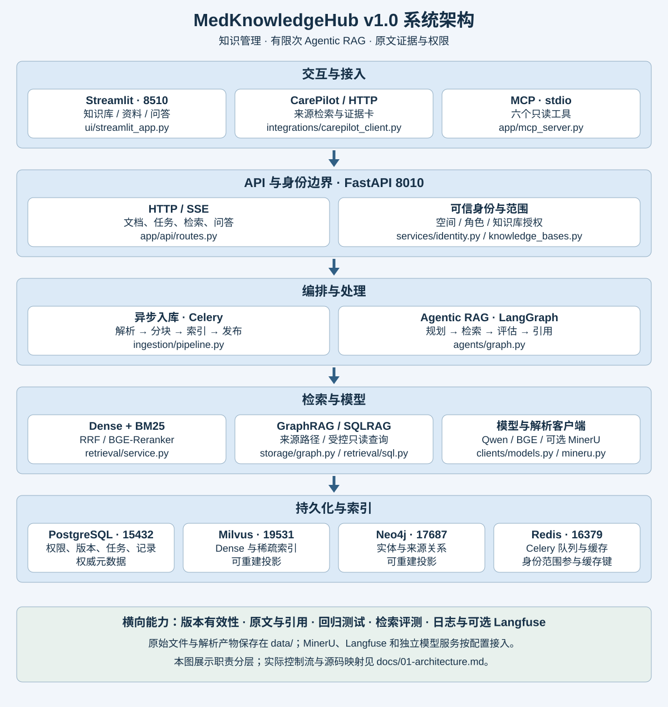

# MedKnowledgeHub

MedKnowledgeHub 是一个独立的医疗知识管理与 Agentic RAG 项目。它将资料解析、结构分块、版本索引、混合检索、图关系查询和受控 SQL 查询连接为完整链路，通过 FastAPI 和 MCP 向上层应用提供证据。Streamlit 页面用于管理知识库、查看文档版本、问答、检查检索结果和提交反馈。

项目版本为 **1.0.0**。初始语料是少量有来源的中文阅读笔记与项目科室目录；软件功能范围和知识覆盖范围是两件事。系统不提供医学诊断、处方或医院实时号源。



## 已实现的主要链路

| 能力 | 实现与入口 |
| --- | --- |
| 多知识库与权限 | 独立知识空间，admin/editor/viewer，受限知识库授权；`app/services/knowledge_bases.py` |
| 文档入库 | PDF、Markdown、TXT、HTML、DOCX、XLSX、JSON；异步任务、状态、去重与重试；`app/ingestion/` |
| 结构化证据 | 标题路径、父子块、PDF 页码与坐标、原文读取；`app/ingestion/chunking.py` |
| 混合检索 | BGE-M3、Milvus Dense + 原生 BM25、RRF、BGE-Reranker；`app/retrieval/service.py` |
| Agentic RAG | 规划知识库、按需改写/HyDE/拆分、有限次检索、上下文预算、引用检查；`app/agents/graph.py` |
| 图关系查询 | Neo4j 中的原文支持关系与最多三跳路径；`app/storage/graph.py` |
| 结构化查询 | Text-to-SQL、AST 校验、权限子查询、只读事务和结果限制；`app/retrieval/sql.py` |
| 版本治理 | 发布后切换当前版本、生效/失效日期、归档、缓存失效与版本对比 |
| 服务复用 | HTTP 检索、SSE 问答、六个 MCP 只读工具、CarePilot 客户端适配器 |
| 评测与观测 | 检索消融、RAGAS 入口、反馈、Prometheus、可选 Langfuse |

## 技术栈

Python 3.11、FastAPI、Streamlit、LangChain、LangGraph、Qwen、BGE-M3、BGE-Reranker、PostgreSQL、Milvus、Neo4j、Redis、Celery、SQLAlchemy、Alembic、SQLGlot、MCP、Docker。普通 PDF 使用 PyMuPDF，Office 使用 python-docx/openpyxl；扫描件通过可配置的 MinerU V1 服务解析。Langfuse 是可选观测依赖，RAGAS 使用独立评测环境，见 [运行手册](docs/02-quickstart.md)。

## 本机快速启动

进入项目根目录，创建本项目的独立虚拟环境并填写自己的配置。

```powershell
py -3.11 -m venv .venv
.\.venv\Scripts\python.exe -m pip install -e ".[dev,observability]"
.\.venv\Scripts\python.exe -m scripts.configure
# 编辑 .env，填写 OPENAI_API_KEY

docker compose up -d postgres redis neo4j milvus
.\.venv\Scripts\python.exe -m scripts.bootstrap
```

在三个终端分别执行：

```powershell
.\.venv\Scripts\python.exe -m uvicorn app.main:app --host 127.0.0.1 --port 8010
```

```powershell
.\.venv\Scripts\python.exe -m celery -A app.workers.celery_app:celery_app worker --pool=solo --loglevel=INFO
```

```powershell
.\.venv\Scripts\python.exe -m streamlit run ui/streamlit_app.py --server.address 127.0.0.1 --server.port 8510
```

导入自带资料（只需首次执行；重复执行相同内容与元数据会复用版本）：

```powershell
.\.venv\Scripts\python.exe -m scripts.import_corpus --wait
```

访问 [知识中台](http://127.0.0.1:8510) 和 [API 文档](http://127.0.0.1:8010/docs)。管理员用户名和密码对应本机 `.env` 的 `ADMIN_USERNAME`、`ADMIN_PASSWORD`。注册按钮会创建独立空间，不会共享管理员导入的资料。密钥、密码、数据库及原始文件不提交到 Git。

`run.ps1` 也支持 `infra/init/api/worker/ui/seed/test`。Windows 原生 Worker 使用 solo 池；完整容器部署可运行 `docker compose --profile app up -d --build`，步骤见运行手册。

## 从哪里开始读

先读 [学习路线](docs/00-learning-path.md)，再打开 [架构与源码映射](docs/01-architecture.md)。

| 主题 | 文档 |
| --- | --- |
| 运行与 PyCharm | [02 · 快速开始](docs/02-quickstart.md) |
| 身份、空间与权限 | [03 · 权限设计](docs/03-auth-and-permissions.md) |
| 文档、切分与异步任务 | [04 · 文档入库](docs/04-ingestion.md) |
| 数据库、索引与版本 | [05 · 存储设计](docs/05-storage-and-versions.md) |
| 向量、BM25、融合与重排 | [06 · 混合检索](docs/06-hybrid-retrieval.md) |
| State、规划与循环终止 | [07 · Agentic RAG](docs/07-agentic-rag.md) |
| 图实体与来源路径 | [08 · GraphRAG](docs/08-graph-rag.md) |
| Text-to-SQL 与查询范围 | [09 · SQLRAG](docs/09-sql-rag.md) |
| 上下文与引用验证 | [10 · 证据与引用](docs/10-context-and-citations.md) |
| API、SSE 和 MCP | [11 · 接口与工具](docs/11-api-and-mcp.md) |
| 连接 CarePilot | [12 · CarePilot 集成](docs/12-carepilot-integration.md) |
| 指标、消融与 RAGAS | [13 · 评测](docs/13-evaluation.md) |
| Tracing 与性能 | [14 · 可观测性](docs/14-observability.md) |
| 故障与维护 | [15 · 运维手册](docs/15-operations.md) |
| 项目讲解与面试 | [16 · 面试导读](docs/16-interview-guide.md) |
| 本次真实验证 | [17 · 交付验证记录](docs/17-validation.md) |

## 测试和评测

```powershell
.\.venv\Scripts\python.exe -m pytest -q
.\.venv\Scripts\python.exe -m scripts.check_environment
.\.venv\Scripts\python.exe -m scripts.smoke_live
.\.venv\Scripts\python.exe -m evals.run --strategy rerank
.\.venv\Scripts\python.exe -m evals.run --strategy agentic
```

单元与 API 测试使用受控模型和索引验证逻辑；`smoke_live` 使用真实 HTTP、任务队列、四个基础服务和模型 API，会产生 API 用量。评测报告写入本机 `artifacts/`。八条手工标注样例的结果不能代表医学准确率或大规模检索水平。

## 项目状态

CarePilot 适配器已经提供在 `integrations/carepilot_client.py`，本机 CarePilot 已通过后端适配器接入，统一启动与配置见同级 care-suite。扫描件解析需要 MinerU 服务地址；Langfuse 需要对应项目凭据；使用现有硅基流动 API 时无需本机部署 vLLM。独立模型服务可以通过配置替换，不需要修改工作流。

## 联合运行

两个项目已经接通，共享模型与服务凭据统一放在 care-suite/.env。见 [联合运行手册](docs/integration/README.md) 和 [配置清单](docs/integration/01-api-and-keys.md)。
