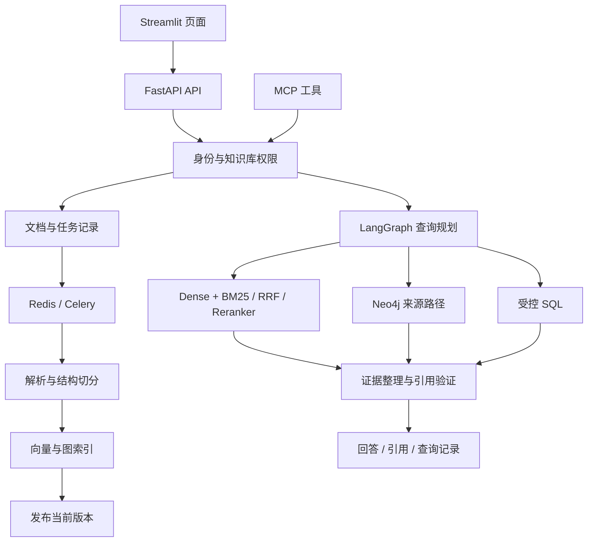

# 整体架构与源码映射

项目包含两条主链路：异步文档入库和在线知识检索。PostgreSQL 保存事实状态，Milvus、Neo4j 是可以重建的检索投影，Redis 支持队列和缓存。文件系统保存原始文件与解析产物。

## 主要文件

| 模块 | 文件 | 关注点 |
| --- | --- | --- |
| 服务入口 | `app/main.py`、`app/runtime.py` | 生命周期、依赖装配、错误与健康状态 |
| HTTP 接口 | `app/api/routes.py`、`app/schemas.py` | 登录、知识库、文档、任务、检索、问答、反馈 |
| 元数据 | `app/models.py`、`app/storage/database.py` | 表、事务与连接管理 |
| 权限 | `app/services/identity.py`、`knowledge_bases.py` | 服务端身份、显式授权、可读版本范围 |
| 文档管理 | `app/services/documents.py` | 上传、版本、删除、原文与版本对比 |
| 入库 | `app/ingestion/parsers.py`、`chunking.py`、`pipeline.py` | 解析、定位、切分、投影与发布 |
| 在线编排 | `app/agents/state.py`、`graph.py` | 查询规划、路由、补充检索和终止 |
| 检索 | `app/retrieval/service.py`、`fusion.py`、`context.py` | 召回、融合、精排和上下文 |
| 专项查询 | `app/storage/graph.py`、`app/retrieval/sql.py` | 图路径与受控 SQL |
| 模型边界 | `app/clients/models.py`、`mineru.py` | 模型接口、缓存和外部解析 |
| 异步执行 | `app/workers/celery_app.py` | 队列、重试和索引维护 |
| 外部工具 | `app/mcp_server.py` | 六个只读工具及服务身份 |
| 交互 | `ui/streamlit_app.py` | 页面状态、HTTP 与 SSE |
| 验证 | `tests/`、`scripts/smoke_live.py`、`evals/` | 受控测试、真实链路和评测 |

## 一次入库

1. API 确认当前用户可修改目标知识库，校验文件，创建 Document、Version 与 IngestionTask。
2. Celery Worker 领取任务，解析文件并构造来源定位、父子块和结构化记录。
3. 生成向量，写入 Milvus；抽取带原文支持的关系并写入 Neo4j。
4. 外部投影完成后，在 PostgreSQL 事务中切换 `active_version_id`，增加知识库 epoch。
5. 清理旧投影。清理失败也不会让旧版本重新被检索，因为查询范围由 PostgreSQL 决定。

## 一次问答

1. API 从 Bearer token 定位用户和空间，不接受客户端声明的角色或 tenant_id。
2. 服务计算可读知识库、当前有效版本与缓存签名。
3. LangGraph 选择查询方式；简单问题保持原查询，复杂问题按需增强。
4. 检索前过滤范围，召回后再次用 PostgreSQL 校验证据；必要时有限次补充检索。
5. 整理上下文并生成结构化结论，检查引用 ID 与逐字证据，再展示回答。
6. 保存当前用户的查询记录、耗时和反馈入口。

## 为什么没有照着规划拆成上百个空文件

相邻职责放在同一个可阅读模块中，例如 `models.py` 集中定义元数据表，`routes.py` 集中列出 v1 接口。目录按实际实现组织；当模块复杂度上升时再拆分。完整能力的证据来自执行链路和测试，而不是文件数量。
