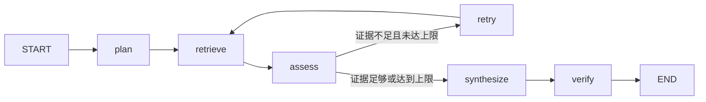

# LangGraph：规划、检索与有限次修正

阅读 `app/agents/state.py` 和 `app/agents/graph.py`。这个图组织有边界的知识查询，不负责自动诊断。

## State 中的主要数据

`query/history` 保存问题及有限历史；`scope/initial_kb_ids` 保存可信授权范围；`plan/route/queries` 保存规划；`hits/sql/debug` 保存检索结果；`attempts/sufficient` 决定是否继续；`citations/claims/answer/warnings` 保存经过处理的输出。

查询之间不共享可变 State。页面可提交最近八条对话帮助理解指代，权限仍从当前 token 重新计算。RAG 查询本身不使用 CarePilot 的问诊 checkpoint。

## 规划节点

模型只看到可读知识库的说明。`QueryPlan` 用 Pydantic 校验 route、kb_ids、queries、entities、strategy；不允许模型扩大授权范围。简单问题保持原始查询，复杂问题按需改写或拆成最多三条查询。HyDE 的假设段落只参与召回，永远不能作为答案证据。

显式选择 hybrid/graph/sql 会优先于模型建议。规划失败时保留原问题及可读范围，记录提示。关闭 enhance 后仍可测试基础检索，便于消融。

## 证据不足怎么办

assess 依据是否存在足够相关的片段判断，SQL 路径依据真实查询结果判断。证据不足且未到配置上限时，retry 改写问题并恢复原始可读知识库范围，用混合检索补充。总检索次数最多配置为三次，默认两次。

这是一条有限状态工作流，并不意味着模型可以任意调用工具或无限搜索。相关实现模式参考 [LangGraph 工作流文档](https://docs.langchain.com/oss/python/langgraph/workflows-agents)。

## 生成与校验

文本答案先生成 claims，每条绑定来源 ID 与逐字引文。verify 移除无效来源、伪造引文或空结论。SQL 统计和表格直接由受控执行结果格式化，避免模型把“多少个”改写成无关的条目清单。

练习：关闭增强运行一次，再打开增强，比较 plan、queries、attempts 和最终引用。用未收录的问题检查循环终止与无答案提示；对应 `test_rag.py`。
