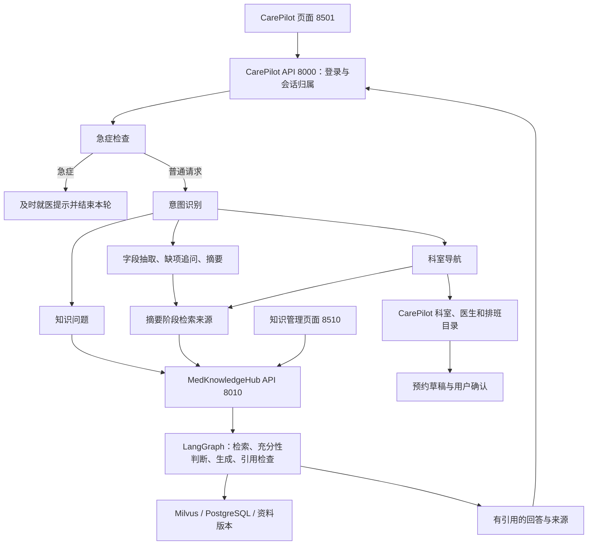

# 集成架构与源码追踪

## 请求链路

知识中台完整保留自动路由、图关系、受控 SQL 与 MCP。CarePilot 的医学解释固定为 hybrid，关闭首次查询增强，减少单次请求规划开销；仍保留知识服务的有限补充检索和引用验证。要体验图和 SQL，可在知识中台选择对应模式。

## 逐步定位文件

路径均从两个项目的共同父目录开始。

| 环节 | 文件 | 阅读重点 |
| --- | --- | --- |
| 页面 | carepilot/ui/streamlit_app.py | 消息、引用卡、版本、原文按钮 |
| 患者鉴权 | carepilot/app/api/consultations.py | 当前用户与 session_id 归属 |
| 工作流 | carepilot/app/agents/graph.py | safety 优先，知识问题与问诊分流 |
| 查询背景 | carepilot/app/agents/nodes/knowledge.py | 当前问题、主诉及症状变化的长度限制 |
| 知识回答 | carepilot/app/agents/nodes/dialogue.py | 保留引用；超时不改成无来源自由生成 |
| HTTP 客户端 | carepilot/app/services/medknowledgehub.py | 服务 token、超时、拒绝重定向、引用契约 |
| 后端装配 | carepilot/app/main.py、app/services/knowledge.py | 按配置创建远端或本地检索服务 |
| 原文代理 | carepilot/app/api/knowledge.py | 患者先登录，后端再请求知识服务 |
| 服务身份 | medknowledgehub/scripts/bootstrap.py | viewer 角色及哈希 token |
| 知识接口 | medknowledgehub/app/api/routes.py | answers、knowledge/search、sources |
| 权限与版本 | medknowledgehub/app/services/knowledge_bases.py | 可见库、授权和有效版本 |
| 混合检索 | medknowledgehub/app/retrieval/service.py | Dense/BM25、RRF、重排、回表校验 |
| 回答与校验 | medknowledgehub/app/agents/graph.py | 来源编号、原文引句和有限重试 |
| 统一配置 | 两边 app/core/config.py、care-suite/configure.py | 两层 env 文件与配置迁移 |

## 两种身份

CarePilot 账号代表患者及其会话、预约；MedKnowledgeHub 账号代表知识空间权限。后端服务账号是 viewer，患者 token 不转发给知识服务，服务 token 不发送给浏览器。

当前是一个 CarePilot 实例共享一个管理员授权的知识空间。服务身份可读取同空间 tenant 可见库和被授予的 restricted 库；患者会话隔离仍由 CarePilot 负责。内部资料应放进未授权给服务账号的 restricted 库，不能假定每位患者自动拥有独立知识空间。

## 每轮证据状态

| knowledge_status | 含义 |
| --- | --- |
| not_requested | 本轮无知识查询，例如普通追问或急症 |
| retrieved | 摘要或科室分支取得来源片段 |
| answered | 回答带有通过契约检查的引用 |
| no_evidence | 没有足够证据 |
| unavailable | 超时、鉴权或上游失败 |

每轮先清空旧 sources；失败不会擦除已记录的就诊信息，也不会阻断目录及预约。知识问题无足够依据时明确说明，不继续拼接上一轮来源。日志仅记录异常类型，不向患者暴露凭据和上游原始响应。

查询只传当前问题、有限主诉和症状变化，不自动转发账号、完整对话、报告或预约。摘要仍可能含用户输入的敏感信息，且知识服务保留查询记录。

知识库目录与 CarePilot 预约目录不同：推荐和预约只能使用业务目录中的可预约科室，不将知识库条目伪装成实时号源。引用编号和逐字引句校验也不等于医学结论必然正确，仍需检查来源、适用范围与答案语义。

## 学习练习与面试讲解

先在页面提一个知识问题，按表追到 HTTP 适配器、知识工作流、版本和原文。再在知识中台发布新版本，重复提问比较引用版本；临时停止知识 API，观察问答降级和预约目录仍然可用，不要删除数据卷制造故障。

面试可围绕服务边界、可信身份、故障降级和证据追溯展开。展示真实请求、引用和失败样例；未经独立测量，不把集成描述为准确率或性能提升百分比。
